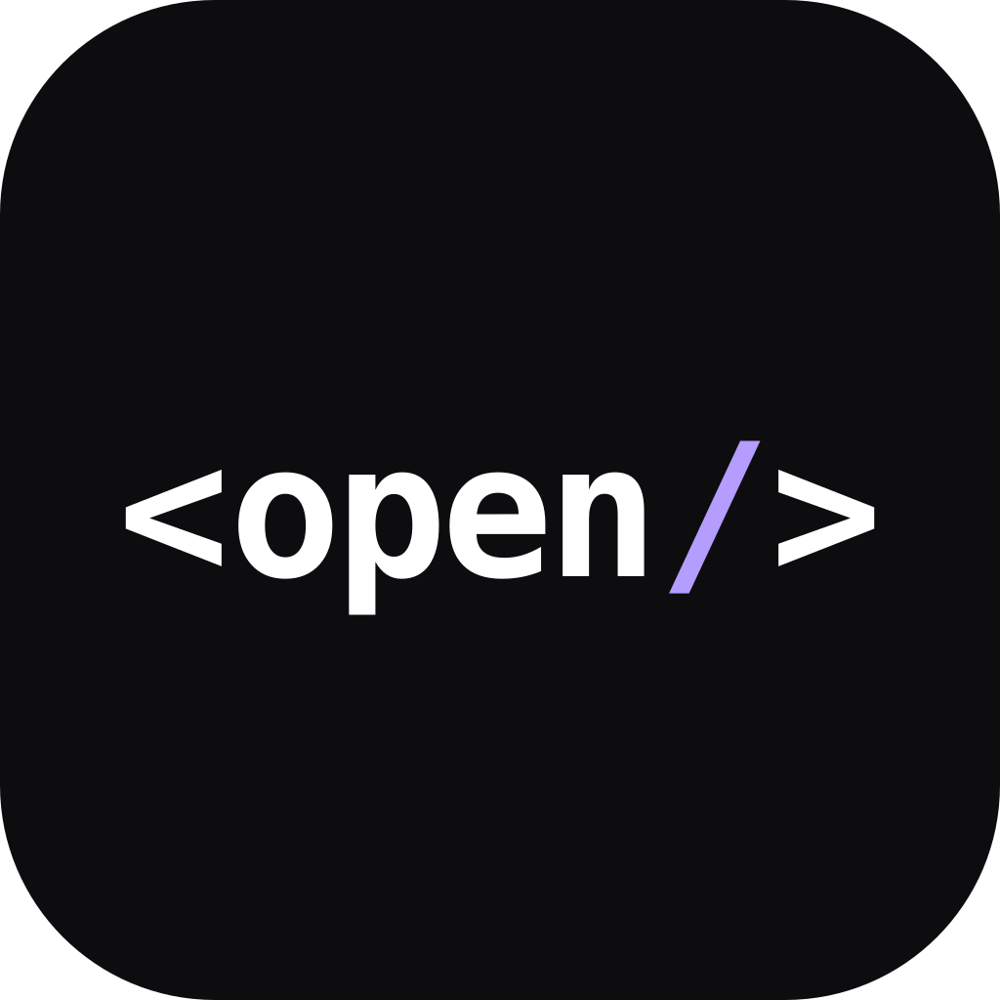

<p align="center">
  
</p>

# OpenElement

<p align="center">
  <a href="https://www.bestpractices.dev/projects/16052"></a>
  
  
  
  =24.2" />
</p>

English | [简体中文](./README.zh.md)

OpenElement is a Web Platform-first core for two products: **Element** and **Router**.
Element compiles JSX-authored Custom Elements into a Part Program used by server serialization, fresh DOM, and existing-DOM hydration. Router owns route selection, HTTP semantics, navigation, loaders, actions, and the shared Native/Lit Framework Mode application contract.

The source tree is `1.0.0-alpha.15`, a new public baseline for Element and Router. It is not a compatibility migration from historic 0.x snapshots. From this release the six packages (`protocol`, `element`, `compiler`, `router`, `create`, `ui`) publish as one line, and npm `latest` points at that line — `npm install @openelement/router` resolves to the current 1.0 prerelease. Since #1557 the Element monolith is three packages: `@openelement/protocol` (cross-system contracts, zero dependencies), `@openelement/element` (pure runtime), and `@openelement/compiler` (build-time TSX-to-Part-Program compiler + Vite plugin).

## Evidence & recognition

These references are reproducible and verifiable by third parties.

- [Software Heritage](https://archive.softwareheritage.org/browse/origin/directory/?origin_url=https://github.com/open-element/openelement)
- [js-framework-benchmark](https://krausest.github.io/js-framework-benchmark/) — available from v1.0.0-alpha.4 onward
- [deps.dev package view](https://deps.dev/npm/%40openelement%2Frouter) and npm provenance attestations on [npm](https://www.npmjs.com/package/@openelement/router)
- Bundle size via [Bundlephobia](https://bundlephobia.com/package/@openelement/element)

## Quick Start

Requires **Node.js 24.2+ (24.18.0 recommended)** and a package manager: npm,
pnpm, yarn, or bun (the scaffolder installs with whichever one it finds on
`PATH`, and the generated project is package-manager neutral). Create, run, and
build — the generator installs the dependencies itself, so there is no separate
install step:

```bash
npm create @openelement my-app
cd my-app
npm run dev
npm run build
```

Add a page — one compiled element plus one route record:

```tsx
// app/components/page-hello.tsx
import { element, OpenElement } from '@openelement/element';

@element('hello-page', { root: 'shadow-open' })
export default class HelloPage extends OpenElement {
  render() {
    return (
      <main>
        <h1>Hello from OpenElement</h1>
      </main>
    );
  }
}
```

```tsx
// app/routes/hello.tsx
import { definePage } from '@openelement/router';
import HelloPage from '../components/page-hello.tsx';

export default definePage(HelloPage, {
  head: { title: 'Hello' },
});
```

Re-run `npm run dev`, open the URL Vite prints plus `/hello`, and `npm run build` emits the static-first `dist/` output. Full walkthrough: <https://openelement.org/guide/getting-started>.

**Build-time host:** Framework Mode development and builds run on Node.js
24.2+ through pnpm scripts (ADR-0161, superseding the Deno-native decision in
ADR-0108): the `@openelement/router` tooling subpaths (`./vite`, `./cli/*`)
are consumed through the starter's own dependency pins as plain Node
programs. The request-time output uses standard ESM and Web
`Request`/`Response`; deployment support is limited to the runtimes and Nitro
targets actually covered by the qualification matrix, not every runtime that
can load ESM. Element remains independently consumable in npm-only projects.

## Features

- Declarative Shadow DOM plus SSR, existing-DOM hydration, and islands that hydrate only where needed.
- Authoring JSX is compiled to a Part Program at build time; there is no runtime virtual-DOM contract.
- Route Mode for explicit route records and Framework Mode for file routes, loaders, actions, and forms.
- Native and Lit renderers behind one application contract; renderer integrations stay explicit.
- Compiled output tree-shakes so server-only modules never leak into the client bundle.

## Repository shape

- `packages/protocol` — the cross-system contract package (#1557): Part Program IR, error dialect,
  admission descriptors; zero dependencies, contracts only.
- `packages/element` — the Element core product: the pure runtime; depends only on protocol plus
  `@preact/signals-core` at publish time.
- `packages/compiler` — the Element compiler (#1557): the TSX-to-Part-Program semantic core and the
  Vite plugin boundary; the only package carrying the TypeScript dependency.
- `packages/router` — the Router core product: Route Mode and Framework Mode plus the application
  lifecycle tooling (`@openelement/router/vite`, `/nitro-mount`, `/cli/*`).
- `packages/create` — the supported creation entry for the two core products.
- `packages/ui` — experimental UI product, maintained in this repository outside the 1.0 stable promise.
- `www` — the official product surface (documentation site).
- `apps/saas` — an independent first-party consumer application, maintained in this repository but separately governed; it is not part of the framework core or the Alpha repository candidate.

Element and Router are the public framework core. UI is an experimental product; Site is the official product surface; SaaS is an independent first-party application governed separately and is not part of the Alpha repository candidate. None extends the Element/Router stable API promise, and all are owned and maintained by this repository. Historical snapshots remain available through Git tags.

## Development

The source repository is a pnpm workspace on Node (`.node-version` pins the
development line, 24.18); published npm artifacts are qualified separately in
disposable npm consumers.

```sh
pnpm install
pnpm run fmt:check
pnpm run lint
pnpm run typecheck
pnpm test
pnpm run build
```

## Documentation

- [Current architecture](./docs/architecture/README.md)
- [Active decisions](./docs/adr/README.md)
- [Security policy](./SECURITY.md)
- [Contributing](./CONTRIBUTING.md)

OpenElement is available under the MIT license.
